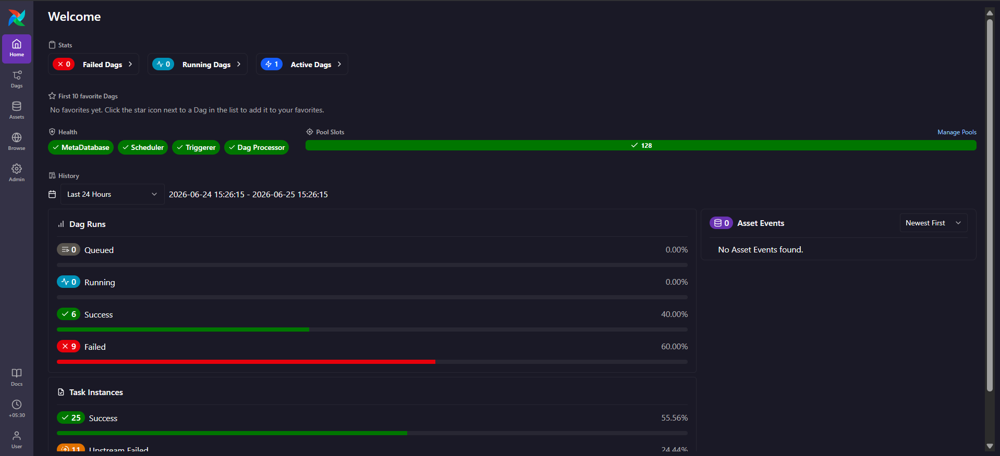
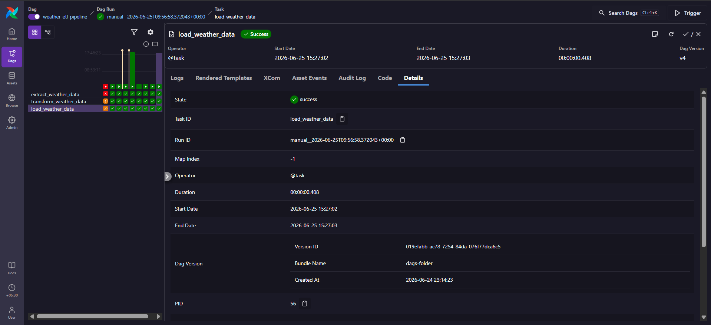
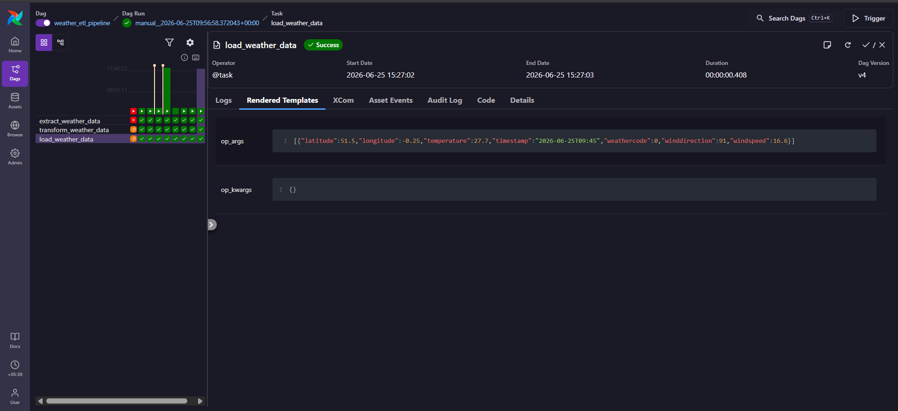

# 🌤️ End-to-End Weather ETL Pipeline with Apache Airflow

<div align="center">


**A production-grade, containerised ETL pipeline that extracts real-time weather data from the Open-Meteo API, transforms it into a clean structured record, and loads it into PostgreSQL — orchestrated end-to-end by Apache Airflow.**

</div>

---

## 📸 Pipeline in Action

<table>
  <tr>
    <td align="center"><strong>Airflow Dashboard — All Systems Healthy</strong></td>
    <td align="center"><strong>Load Task — Successful Execution</strong></td>
    <td align="center"><strong>Rendered Template — Real Weather Data</strong></td>
  </tr>
  <tr>
    <td></td>
    <td></td>
    <td></td>
  </tr>
  <tr>
    <td align="center"><em>Scheduler, Triggerer & MetaDatabase all green. 6 successful DAG runs visible.</em></td>
    <td align="center"><em>load_weather_data task completed in 408ms with state = success.</em></td>
    <td align="center"><em>Transformed payload: London, 27.7°C, windspeed 16.6 km/h, 2026-06-25T09:45.</em></td>
  </tr>
</table>

---

## 📐 Architecture

```
┌──────────────────────────────────────────────────────────────────────┐
│                      Apache Airflow (Astro Runtime)                  │
│                                                                      │
│  ┌─────────────────────┐                                             │
│  │  DAG: weather_etl   │   Schedule: @daily  │  Catchup: False      │
│  │  pipeline           │                                             │
│  └─────────────────────┘                                             │
│                                                                      │
│     ┌─────────────────┐     ┌──────────────────┐     ┌───────────┐  │
│     │  EXTRACT        │────▶│  TRANSFORM       │────▶│  LOAD     │  │
│     │                 │     │                  │     │           │  │
│     │ HttpHook        │     │ Validate payload │     │ Postgres  │  │
│     │ → Open-Meteo    │     │ Flatten JSON     │     │ Hook      │  │
│     │   API           │     │ Type-cast fields │     │ UPSERT    │  │
│     │ XCom push dict  │     │ XCom push dict   │     │ ON CONFLICT│  │
│     └─────────────────┘     └──────────────────┘     └───────────┘  │
└──────────────────────────────────────────────────────────────────────┘
                                                              │
                                                              ▼
                                              ┌───────────────────────┐
                                              │  PostgreSQL 15        │
                                              │  Table: weather_data  │
                                              │  Unique idx: timestamp│
                                              └───────────────────────┘
```

**Data flow:**
1. **Extract** — `HttpHook` calls `GET /v1/forecast?latitude=51.5074&longitude=-0.1278&current_weather=true` on Open-Meteo and pushes the raw JSON dict via XCom.
2. **Transform** — Validates presence of `current_weather`, flattens the nested payload into a flat typed dict (`latitude`, `longitude`, `temperature`, `windspeed`, `winddirection`, `weathercode`, `timestamp`).
3. **Load** — `PostgresHook` performs an idempotent `CREATE TABLE IF NOT EXISTS` + `CREATE UNIQUE INDEX IF NOT EXISTS` followed by `INSERT … ON CONFLICT (timestamp) DO UPDATE` to safely upsert each record.

---

## 🛠️ Tech Stack

| Component | Tool | Version |
|---|---|---|
| Orchestration | Apache Airflow | 3.x (Astro Runtime 3.2-5) |
| Runtime | Astronomer Astro CLI | Latest |
| Containerisation | Docker + Docker Compose | ≥ 24 |
| Weather Source | [Open-Meteo API](https://open-meteo.com/) | Free, no key needed |
| Data Store | PostgreSQL | 15-alpine |
| Language | Python | 3.11 |
| Airflow Providers | `apache-airflow-providers-http` | Latest |
|  | `apache-airflow-providers-postgres` | Latest |

---

## 📂 Project Structure

```
end_to_end_etl_pipeline_airflow/
│
├── dags/
│   ├── etl_weather.py          # 🌟 Main ETL DAG (Extract → Transform → Load)
│   └── check_data_dag.py       # 🔧 Utility DAG — query weather_data table
│
├── screenshots/
│   ├── airflow_dashboard.png   # Airflow home dashboard
│   ├── load_task_success.png   # Load task success detail
│   └── rendered_template_data.png  # Real weather data flowing through
│
├── include/                    # Additional resources (empty by default)
├── plugins/                    # Custom Airflow plugins
├── tests/                      # Unit & integration tests
│
├── check_data.py               # Standalone PostgreSQL verification script
├── docker-compose.yml          # Postgres service for local development
├── Dockerfile                  # Astro Runtime base image
├── requirements.txt            # Python provider dependencies
├── airflow_settings.yaml       # Local Airflow connections (not committed)
├── .env.example                # Environment variable template
└── README.md
```

---

## 🚀 Quick Start

### Prerequisites

| Tool | Installation |
|---|---|
| Docker Desktop | [docs.docker.com](https://docs.docker.com/get-docker/) |
| Astronomer Astro CLI | [Install guide](https://www.astronomer.io/docs/astro/cli/install-cli) |
| Git | [git-scm.com](https://git-scm.com/) |

### 1 — Clone the repository

```bash
git clone https://github.com/AbhijeetArunGore/end_to_end_etl_pipeline_airflow.git
cd end_to_end_etl_pipeline_airflow
```

### 2 — Set up environment variables

```bash
cp .env.example .env
# Edit .env if you need custom credentials (defaults work out of the box)
```

### 3 — Start Airflow locally

```bash
astro dev start
```

This spins up **five Docker containers**:

| Container | Purpose | Port |
|---|---|---|
| Postgres | Airflow Metadata Database | — |
| Scheduler | Monitors and triggers DAGs | — |
| DAG Processor | Parses DAG files | — |
| API Server / Webserver | Airflow UI | `8080` |
| Triggerer | Handles deferred tasks | — |

The UI opens automatically at **http://localhost:8080**
- Username: `admin` · Password: `admin`

### 4 — Verify Airflow connections

The `airflow_settings.yaml` file pre-configures two connections:

| Connection ID | Type | Purpose |
|---|---|---|
| `open_meteo_api` | HTTP | Open-Meteo base URL |
| `postgres_default` | Postgres | Local PostgreSQL |

To check: **Admin → Connections** in the Airflow UI.

### 5 — Trigger the pipeline

In the Airflow UI, find **`weather_etl_pipeline`** and click the ▶ **Trigger** button (top-right).  
Watch all three tasks turn green: `extract_weather_data` → `transform_weather_data` → `load_weather_data`.

### 6 — Verify data in PostgreSQL

**Option A — via the utility DAG:**
Trigger the `check_weather_data` DAG and inspect its task logs.

**Option B — via the CLI script:**
```bash
# Inside the Airflow container
astro dev bash
python /usr/local/airflow/check_data.py

# Or locally (requires psycopg2-binary)
pip install psycopg2-binary
python check_data.py --host localhost
```

Expected output:
```
========================================================================
  WEATHER DATA FROM POSTGRESQL DATABASE
========================================================================
  Total rows : 1
  Columns    : latitude, longitude, temperature, windspeed, winddirection, weathercode, timestamp, ingested_at
------------------------------------------------------------------------
  51.5 | -0.25 | 27.7 | 16.6 | 91 | 0 | 2026-06-25 09:45:00 | 2026-06-25 09:57:03.xxx+00
========================================================================
```

---

## 🗄️ Database Schema

```sql
CREATE TABLE weather_data (
    latitude       DOUBLE PRECISION NOT NULL,
    longitude      DOUBLE PRECISION NOT NULL,
    temperature    DOUBLE PRECISION NOT NULL,   -- °C
    windspeed      DOUBLE PRECISION NOT NULL,   -- km/h
    winddirection  DOUBLE PRECISION NOT NULL,   -- degrees (0–360)
    weathercode    INTEGER          NOT NULL,   -- WMO weather code
    timestamp      TIMESTAMP        NOT NULL,   -- UTC observation time
    ingested_at    TIMESTAMPTZ      NOT NULL DEFAULT CURRENT_TIMESTAMP
);

-- Unique constraint prevents duplicate records for the same observation window
CREATE UNIQUE INDEX weather_data_timestamp_uidx ON weather_data (timestamp);
```

### WMO Weather Code Reference (selection)

| Code | Condition |
|---|---|
| 0 | Clear sky |
| 1–3 | Partly / mainly cloudy |
| 45, 48 | Fog |
| 61–67 | Rain (light → heavy) |
| 71–77 | Snow |
| 80–82 | Rain showers |
| 95 | Thunderstorm |

Full reference: [open-meteo.com/en/docs#weathervariables](https://open-meteo.com/en/docs#weathervariables)

---

## ⚙️ Configuration Reference

| File | Purpose | Committed? |
|---|---|---|
| `airflow_settings.yaml` | Local Airflow connections & variables | ❌ (in `.gitignore`) |
| `.env` | Runtime environment variables | ❌ (in `.gitignore`) |
| `.env.example` | Template — copy to `.env` | ✅ |
| `requirements.txt` | Python provider packages | ✅ |
| `Dockerfile` | Astro Runtime base image | ✅ |

### Changing the monitored city

Edit the constants at the top of `dags/etl_weather.py`:

```python
LATITUDE  = "51.5074"   # London — change to your city
LONGITUDE = "-0.1278"
```

Find coordinates at [latlong.net](https://www.latlong.net/).

---

## 🧪 Running Tests

```bash
# Run the Astro test suite
astro dev pytest tests/

# Or directly with pytest (inside container)
astro dev bash
pytest tests/ -v
```

---

## 🛑 Stopping the Environment

```bash
astro dev stop        # Stop all containers (preserves data)
astro dev kill        # Stop + delete all containers and volumes
```

---

## 🔍 Key Design Decisions

| Decision | Rationale |
|---|---|
| **TaskFlow API (`@task` decorator)** | Cleaner Python-native syntax; automatic XCom serialisation without boilerplate |
| **`ON CONFLICT … DO UPDATE`** | Idempotent loads — re-running the DAG never creates duplicate rows |
| **`CREATE TABLE IF NOT EXISTS`** | No migration tool required; the DAG self-bootstraps the schema on first run |
| **`CREATE UNIQUE INDEX IF NOT EXISTS`** | Ensures the upsert constraint exists before data insertion, regardless of run order |
| **`catchup=False`** | Prevents a backlog of historical runs on first deployment |
| **`retries=2` with default retry delay** | Transient network blips to Open-Meteo won't permanently fail the DAG |
| **Open-Meteo (free, no API key)** | Zero configuration overhead; ideal for a portfolio demonstration |

---

## 📈 Potential Enhancements

- [ ] Add data quality checks with [Great Expectations](https://greatexpectations.io/) or Airflow's `SQLCheckOperator`
- [ ] Extend to multiple cities using Airflow's dynamic task mapping
- [ ] Add a Grafana / Metabase dashboard for weather trend visualisation
- [ ] Send email / Slack alerts on DAG failure via Airflow callbacks
- [ ] Deploy to Astronomer Cloud or AWS MWAA for a fully managed production setup
- [ ] Add `retry_delay` and `email_on_failure` to `default_args`

---

## 👨‍💻 Author

**Abhijeet Arun Gore**  
Data Engineering Enthusiast · Python · Apache Airflow · PostgreSQL · Docker

[](https://github.com/AbhijeetArunGore)

---

## 📄 License

This project is licensed under the **MIT License** — see [LICENSE](LICENSE) for details.
